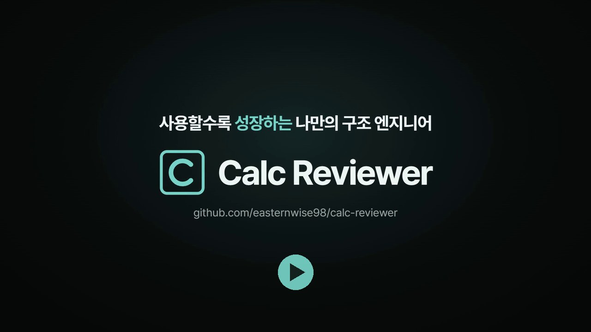

https://github.com/user-attachments/assets/4aa87687-74ba-40ef-a257-b53009db70bd
# Calc Reviewer

구조계산서를 국가건설기준(KDS, KCS)과 대조해 검토하는 윈도우 프로그램입니다.
엑셀이나 PDF 계산서를 넣고 검토를 시작하면, KCSC 최신 설계기준 및 참고 자료와 검토 지식을 활용하여
검토 보고서를 생성합니다.

현재 버전은 **2.1.1**로 설치 파일은 [릴리스 페이지](https://github.com/easternwise98/calc-reviewer/releases/latest)에서 받습니다.

https://github.com/user-attachments/assets/52bab375-9a4e-4b30-b318-14f83826a324

그림을 누르면 영상 파일이 다운로드 됩니다.
---

## 왜 만들었나

계산서 한 권을 검토하다 보면 시간 대부분이 조항을 찾아 펼치고 숫자를 다시 두드려 보는 데 들어갑니다.
정작 판단이 필요한 곳은 몇 군데 안 되는데, 그 몇 군데를 찾으려고 나머지를 전부 훑어야 합니다.

Calc Reviewer는 그 훑는 일을 먼저 해 둡니다. 계산서를 처음부터 끝까지 읽고, 맞는 조항을 찾아 대조하고,
계산을 다시 해 봅니다. 검토자는 짚어 준 자리를 보고 맞는지 판단하는 데만 시간을 쓰면 됩니다.

## 검토는 세 갈래로 동시에 돕니다

- **중점 검토 - 주요 내용 파악하기**: AI가 계산서를 통째로 읽으면서 이상해 보이는 곳을 짚고, 계산서 원문과 기준 조항 원문을 맞대어 판정합니다.
- **전수 점검 - 설계기준과 대조하기**: 하중, 계수, 재료, 설계식, 인용 조항처럼 계산서에서 뽑아낸 항목을 하나도 빼지 않고 기준과 대조합니다.
- **자동 검산 - 계산 검토하기**: 산술, 철근 표기와 단면적, 기준식 재계산, 계산해 놓고 다음 표로 넘기지 않은 값을 프로그램이 직접 다시 계산합니다.

각 판정마다 계산서의 원문과 기준 조항 원문이 같이 제시됩니다. AI가 찾은 인용이 원문에 정말 있는지는 프로그램이 한 번 더 확인하고,
확인되지 않은 판정은 확정하지 않고 사용자에게 판단을 요청합니다. 기준이 따로 정하지 않는 항목(합산, 단위 환산, 시트 사이 값의 일치 같은 것)은
에이전트가 자체적으로 계산서 안의 값으로 다시 계산해 맞는지 봅니다.

예시 계산서로 검토를 통해 나온 이슈는 다음과 같습니다.

- 지진 시 하중집계에서 뒤채움 흙의 관성력을 계산해 놓고 표에는 0으로 넣은 것. 반영하면 활동 안전율이 1.46에서 1.10으로 떨어져 기준 1.2에 못 미칩니다.
- 사용철근은 H16 @ 250인데 철근량은 H19 단면적으로 계산한 것(1,146 mm², 맞는 값 794.4 mm²)
- 전도모멘트를 수식 대신 값으로 적으면서 생긴 산술 오류
- 지진 시 지지력 안전율을 기준(2.0)보다 낮은 1.5로 적용한 것, 안전율 기준을 잘못된 조항 번호로 인용한 것
- 흙에 묻히는 저판의 피복 두께와 배수공 간격이 기준에 못 미치는 것

## 주요 기능

### 검토 결과 화면

현황에서 결정이 필요한 것, 확인이 필요한 것, 기준이나 근거를 보완해야 하는 것이 몇 건인지 먼저 보이고,
해설자가 같은 원인끼리 묶은 우선 이슈와 총평이 이어집니다. 오른쪽 목록에서 항목을 누르면 카드가 열리고,
왼쪽에는 그 셀이 표시된 계산서 시트가 함께 열립니다. 시트는 왼쪽 목차에서 고르거나 한 칸씩 넘겨 볼 수 있습니다.

카드마다 AI 검토 의견을 채택, 보류, 기각하고 메모를 남깁니다. 결정은 따로 저장할 필요 없이 바로 저장됩니다.
근거가 부족하면 조항이나 근거를 더해 그 항목만 다시 판정받을 수 있고, AI가 놓친 곳이 보이면
계산서에서 그 셀을 오른쪽 클릭해 그 자리만 검토를 요청할 수 있습니다.

### 에이전트와 기준 검색

화면 아래의 에이전트(/ 또는 Ctrl+K)에게 검토 결과, 기준, 계산서에 대해 물어볼 수 있습니다.
"이 판정은 왜 이렇게 나왔나", "관성력을 넣으면 안전율이 어떻게 되나" 같은 질문에 열린 검토 결과를 근거로 답하고,
비교가 필요하면 표와 그래프로 만들어 추가 분석 노트로 남깁니다. 이 노트는 검토의견서에 실을 수 있습니다.

기준 검색 창에서는 어느 화면에서든 KDS, KCS 조항 원문을 찾아 읽을 수 있습니다. 떠 있는 창이라 계산서를 보면서 함께 볼 수 있습니다.

### 보고서

검토의견서, 조치의견서, 검토 기록, 부록 가운데 필요한 문서를 골라 내보냅니다. 검토의견서는 미리보기 표 안에서
문구를 바로 고치거나 의견을 넣고 뺄 수 있고, 아직 결정하지 않은 의견은 '미확인'으로 표시되어 빠뜨리지 않게 해 줍니다.

### 검토 모델, 쓸수록 내 기준에 맞춰집니다

검토 모델은 점검표(무엇을 확인할지), 실무 지식(기준에는 없지만 실무에서 보는 판단), 참고 자료(편람이나 해설서 원문)
세 가지 표로 이루어집니다. 프로그램은 검토할 때마다 이 표를 읽습니다.

검토를 마치고 결정을 남기면, 모델 업데이트에서 그 결정과 메모를 모아 AI가 표에 맞게 정리해 줍니다.
같은 내용은 하나로 묶고 새 내용은 더하며, 반영할 때마다 버전이 남아 언제든 되돌릴 수 있습니다.
검토 모델은 파일(.crmod)로 저장해 동료와 주고받을 수 있습니다.

### 파일

검토 결과는 .crrev 파일 하나에 판정, 내 결정, 원본 계산서가 함께 담겨 그대로 다른 PC에서 이어서 볼 수 있습니다.
탐색기에서 .crrev나 .crmod 파일을 두 번 누르면 프로그램으로 바로 열립니다.

---

## 지원 범위

- **파일**: 엑셀 계산서(.xlsx, .xlsm), 텍스트 PDF. 스캔한 PDF는 글자를 읽을 수 없어 받지 않습니다.
- **기준**: KDS, KCS 국가건설기준. 필요하면 국가건설기준센터에 올라온 기관 기준(LHCS, EXCS 등)도 검토 범위에 넣을 수 있습니다.
- **구조물**: 옹벽, 암거, 지하차도, 교각과 교대, 거더, 라멘교, 접속슬래브, 난간벽, 터널 라이닝, 말뚝기초 등. 계산서를 열면 자동으로 판별하고, 틀리면 직접 고르면 됩니다.
- **외국 기준 계산서**: AASHTO, ACI, Eurocode를 따른 영문 계산서도 번역한 뒤 대응하는 국내 기준으로 검토합니다.

검토 시간은 작은 계산서가 3분 안팎, 20시트 규모가 30분 안팎입니다.

## 설치와 준비

릴리스 페이지에서 설치 파일(약 330MB)을 받아 실행하면 됩니다. 파이썬 같은 것을 따로 설치할 필요는 없습니다.

처음 한 번만 두 가지를 준비합니다.

1. `설정 → 검토 준비`에서 검토에 쓸 AI를 고르고 로그인합니다. 본인이 쓰고 있는 ChatGPT 또는 Claude 구독을 그대로 쓰며, 따로 결제하는 것은 없습니다.
2. `설정 → 설계기준 연결`에 국가건설기준센터(KCSC) API 키를 넣습니다. 키는 KCSC 누리집에서 무료로 발급받습니다.

새 버전이 나오면 프로그램 위쪽에 업데이트 표시가 뜨고, 누르면 다시 설치하지 않고 몇 초 만에 올라갑니다.

## 처음이라면

`도움말 → 사용법`에서 장 다섯 개(검토 시작, 결과와 결정, 보고서, 에이전트와 기준 검색, 검토 모델) 가운데
궁금한 장을 고르면 실제 화면을 짚어 가며 안내합니다. `도움말`의 예시 계산서, 예시 검토 결과, 예시 검토 모델로
AI 사용량을 쓰지 않고도 결과 화면과 모델 업데이트를 둘러볼 수 있습니다. 예시 계산서에는 위에 적은 오류들이 일부러 들어 있습니다.

## 알아둘 것

- **최종 판단은 사람이 합니다.** 이 프로그램은 검토를 대신하는 도구가 아니라, 볼 곳을 빠짐없이 찾아 근거를 나란히 놓아 주는 도구입니다.
- 처음 실행할 때 Windows가 파란 경고 창을 띄울 수 있습니다. 코드 서명 인증서를 붙이지 않아서이며, `추가 정보 → 실행`을 누르면 됩니다.
